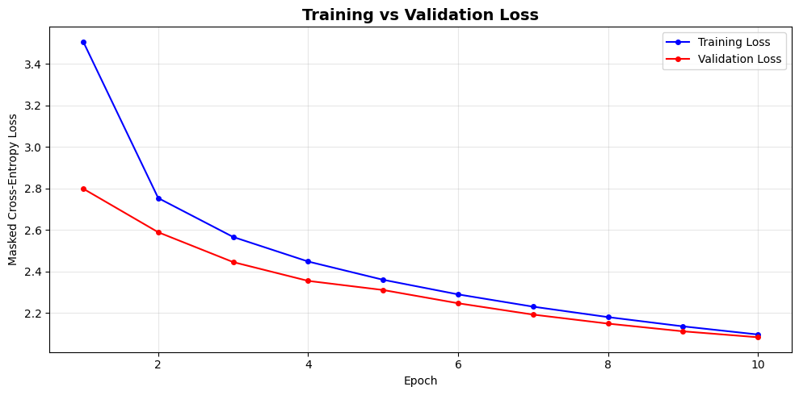
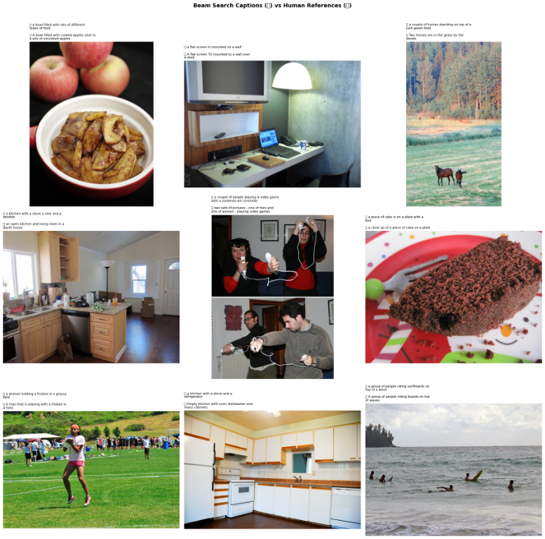

# MS COCO Image Captioning

This repository contains a Kaggle notebook for loading and working with the MS COCO 2014 image-caption dataset.

## Overview

The current notebook:

- Loads training annotations from `captions_train2014.json`
- Defines paths for the training images and generated features
- Creates a feature-output directory
- Prints the top-level keys found in the COCO annotation JSON

The recorded annotation keys are:

```text
dict_keys(['info', 'images', 'licenses', 'annotations'])
```

## Results

The training run produced a training/validation loss curve over 10 epochs. The lowest recorded validation loss was **2.0831**, at **epoch 10**.



The beam-search caption results are shown below. The selected images include the generated beam-search captions alongside human-reference captions.



## Dataset

The notebook uses the following Kaggle dataset paths:

- Dataset: `/kaggle/input/datasets/hariwh0/ms-coco-dataset`
- Training images: `/kaggle/input/datasets/hariwh0/ms-coco-dataset/train2014/train2014`
- Training captions: `/kaggle/input/datasets/hariwh0/ms-coco-dataset/captions/annotations/captions_train2014.json`
- Generated features: `/kaggle/working/features`

## Notebook

The repository notebook is `file_RNN_CNN.ipynb`.

It imports:

- `os`
- `json`
- `random`
- `numpy`
- `tqdm`

For the loss curve, the notebook uses Matplotlib and calculates the epochs from the recorded training history.

## Running the Notebook

1. Open `file_RNN_CNN.ipynb` in Kaggle.
2. Add the `hariwh0/ms-coco-dataset` dataset.
3. Run the notebook with the configured dataset paths.

The existing notebook requires access to `captions_train2014.json` at the Kaggle path shown above.

## Repository Structure

```text
MS-COCO-Image-Captioning/
|-- assets/
|   |-- beam_search_captions.png
|   `-- training_curves.png
|-- file_RNN_CNN.ipynb
|-- README.md
|-- requirements.txt
`-- .gitignore
```
